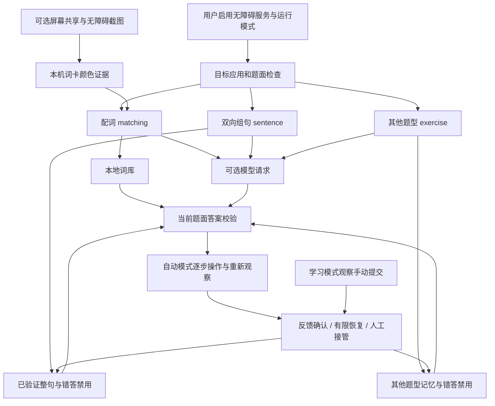

# 架构与数据边界

## 页面识别与运行模式

`MainActivity` 负责模式、题型开关、模型配置及记忆管理。`DuolingoNodeService` 检查目标包名、前台页面与服务状态，再协调配词、组句及其他题型处理器。原有配词路径保留独立的快速扫描，其他页面按需构建题型快照；不能完整识别的页面等待手动处理。

学习模式不自动点击、填写、提交或暂停。自动模式受 11 个独立题型开关控制；模型调用另受默认关闭的 AI 开关控制。题型开关默认开启，保存设置时撤销旧请求及待执行操作。

## 配词：提交与成功分开记录

配词先匹配当前可操作词卡，并参考完整题面的已知翻译关系。固定高亮由 `StablePairHighlights` 管理，不依赖正在执行的点击队列；同文字重复卡按位置区分。

- `DispatchAcceptance` 观察已提交卡片失去可点击状态，在满足完整题面和后续可操作词对等条件时释放点击通道；这不表示配对成功。
- `DeferredPairConfirmation` 为最多五个已提交词对保留独立确认，结合节点变化、绿卡、重复灰卡或稳定换词等证据处理动画残留，禁止重放旧点击。批量提交后不把全局计数增加归给某一对。
- `FinalPairResolver` 仅在完整题面实际剩余唯一可操作、未提交词对并满足观察条件时允许尾对推断。
- `PartialPairRetry`、`VisualPairRetry` 和选中状态策略提供有限补点；灰卡或不确定画面不授权点击。点击前再次检查当前文字、几何、选中状态和页面遮挡。
- `ReplacementBatchWindow` 在旧批次结束后短暂观察新词；`SlowProgressPause` 在无确认进展时协调短暂停、恢复及限时复查，最终仍无证据则交由用户接管。暂停和重复扫描都不计作成功。

`ConfirmationPace` 按最近三秒墙钟时间统计已确认词对，包含暂停耗时。数值反映软件观察结果，不是跨设备速度保证。

## 组句与其他题型

`SentenceReader` 从可访问节点读取题干、词块和控件，排除密码内容。`SentencePage` 与 `ExercisePage` 解析支持的页面、反馈、提交按钮和暂停状态；题目内容是数据，不是对助手的指令。

`SentenceController` 优先使用已验证整句；模型为陌生句返回当前词块编号。`SentencePlan` 检查编号、数量、重复词及置信度，再按当前节点定位。已有正确前缀继续补齐，不匹配前缀从末尾移除；每次操作观察答案区变化，完整序列匹配后才提交。

`ExerciseController` 按题型处理文字选择、填空、阅读、对话、文字输入和其他排列。`ExerciseAnswer` 校验当前选项编号、答案数量及作答方式。输入操作只定位当前题目中可编辑、可见、启用的非密码输入框；请求不包含已有输入框文字。听力和口语只使用明确跳过按钮；仅在自身刚发起跳过且确认页匹配时继续确认，不处理音频。

`SentenceLearning` 与 `ExerciseAttempt` 将本次题面、实际作答和提交证据关联到明确的正确/错误反馈。正确时保存，完整错答进入禁用记录；未知反馈、过期或切题不保存。学习跟踪与自动操作状态分开，允许正常模式切换保留必要的手动提交观察。

计时题请求模型时会尝试暂停，并核实暂停状态；只恢复处理器自己发起且确认过的暂停。组句第一次超时仅在该暂停仍有效时重试一次。模式/题型变化、停止辅助和离开目标应用会取消对应操作与过期请求。

## 模型与存储边界

`AiMatchClient` 通过 HTTPS Chat Completions 请求当前题目的候选文字。所有响应均视为不可信数据，经过各题型协议校验后使用；置信度是模型自评分，无法证明答案正确。

配词候选经 `AiPairValidator` 和 `AiVocabularyAdmission` 校验屏幕原词、一对一关系及已有翻译冲突后保存为 AI 词对。组句与其他题型模型返回的答案不会直接变成已验证记忆，必须等待实际正确反馈。

| 数据 | 存储方式 |
| --- | --- |
| 导入、手动、学习和 AI 词对 | 应用私有目录中的 CSV/TSV |
| 整句正确记忆及错答禁用 | `verified_sentences.json` |
| 其他题型正确记忆及错答禁用 | `verified_exercises.json` |
| 模式、题型开关和模型设置 | 应用偏好设置；API 密钥单独由 Android Keystore 加密 |
| 图像缓冲、待确认队列与近期速率 | 当前运行内存，不写入图片文件 |

`SentenceStore` 使用原子文件写入；整句和其他题型分别存储，正确记录与禁用记录各最多 1000 条。记忆文件未单独加密，不随源码上传。详情及删除能力见 [隐私说明](../PRIVACY.md)。

## 图像与验证范围

`FastCaptureService` 提供用户授权的连续画面；无连续画面时可使用系统支持的无障碍截图。图像仅用于词卡局部颜色状态，不执行 OCR，不加入模型请求。`FreshGreenFrames`、`VisualConfirmationGeometry`、`ScreenshotCadence` 等策略限制帧时效、重复观察、坐标匹配和请求间隔；停止捕获或切换模式时释放资源。系统授权的捕获范围仍可能宽于被采样区域。

JVM 测试覆盖解析、模型协议、状态机和记忆规则。无障碍点击、共享生命周期、具体课程布局及设备时序还需要实际运行验证。历史测试条件和已知限制保留在 [CHANGELOG](../CHANGELOG.md)，不以单元测试替代端到端可用性结论。
